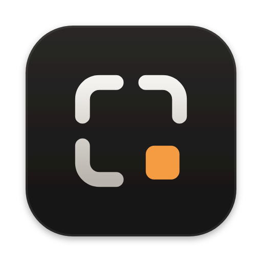
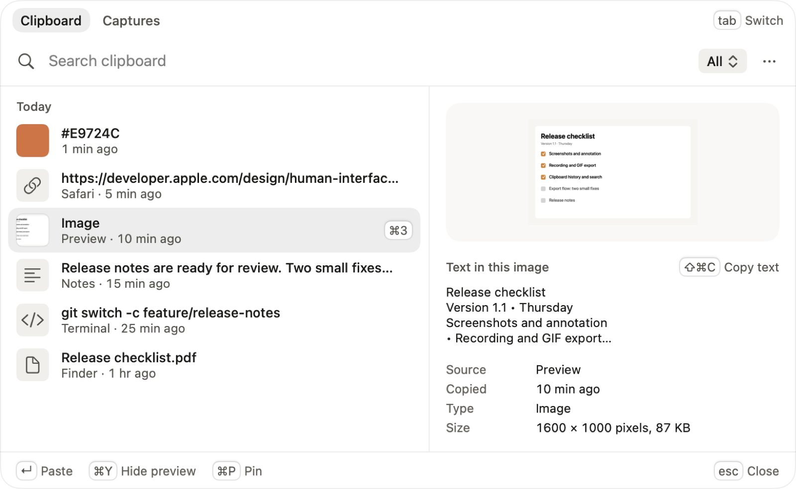
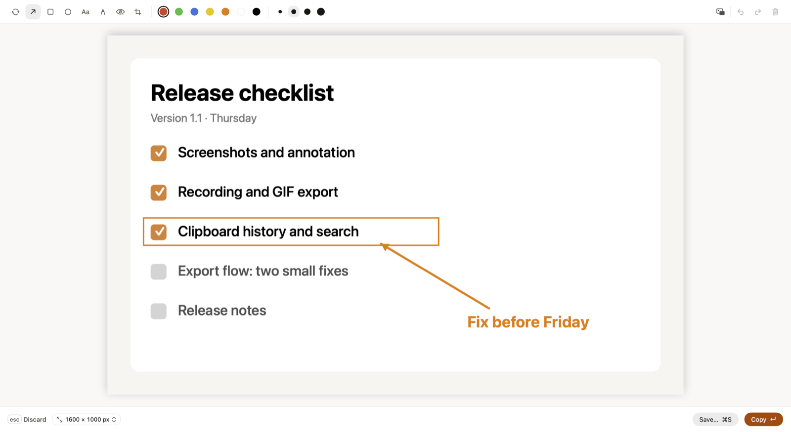
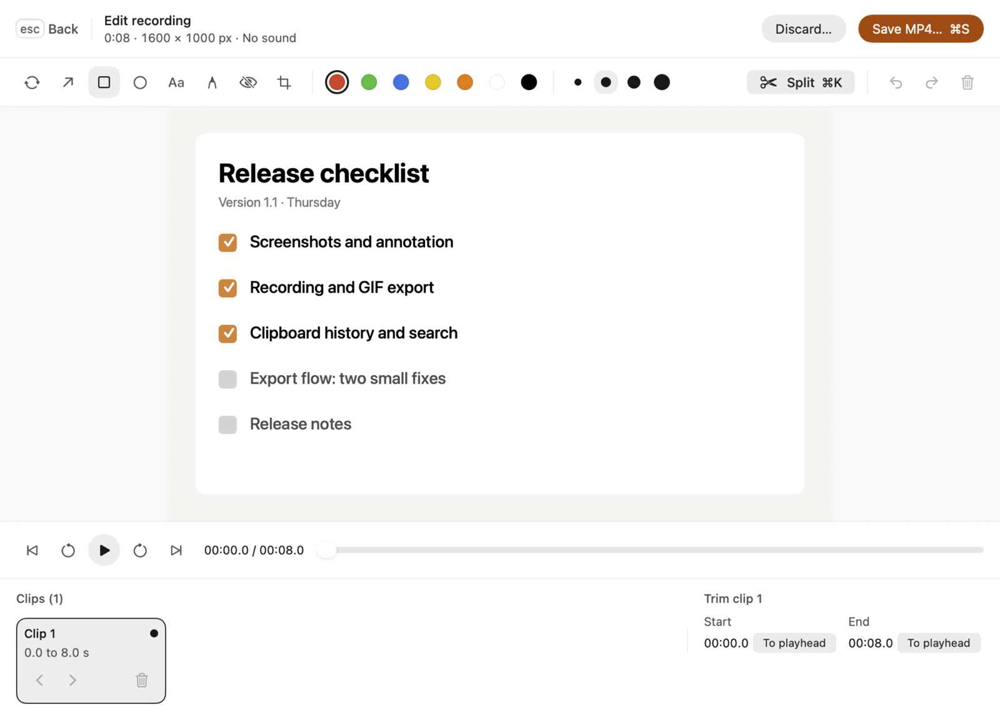

# DocShot

<p align="center">
  
</p>

<p align="center">
  A quiet macOS menu bar tool for screenshots, recordings and clipboard history.<br>
  Local-first: what you capture or copy stays on your Mac.
</p>

<p align="center">
  <strong>Swift 6</strong> · <strong>SwiftUI</strong> · <strong>AppKit</strong> · <strong>ScreenCaptureKit</strong> · <strong>Vision</strong>
</p>

<p align="center">
  <picture>
    <source media="(prefers-color-scheme: dark)" srcset="docs/media/clipboard-dark.png">
    
  </picture>
</p>

## Install

1. Download the latest `.dmg` from [Releases](https://github.com/noel-q/docshot/releases).
2. Open it and drag **DocShot** into **Applications**.
3. Open DocShot from Applications. It lives in the menu bar, not the Dock.
4. Allow **Screen Recording** when macOS asks; DocShot needs it to take screenshots. If you use
   clipboard history, it also asks for **Accessibility** so it can paste into the app you were using.

From build 4, builds are signed with Developer ID and notarised by Apple, so they open without a
security warning. Needs macOS 14 or later. DocShot checks for a newer build once a day and tells you when
there is one; to update, download it and replace the copy in Applications.

## What it does

DocShot lives in the menu bar and keeps every capture explicit: pick exactly what to capture, mark
it up, then copy, save or discard. Clipboard history is there if you want it, and off until you
switch it on. No account, no cloud, no analytics.

### Screenshots

- `⌃⌥⌘S` from any app (rebindable). Hover to pick a window, or drag an exact region across displays.
- A small preview offers Copy, Save, Edit and Discard, so most captures never need the editor.
- The editor has arrows, shapes, text, highlights, opaque redaction, crop, undo and export sizes, with
  single-key tools and Return to copy.

<p align="center">
  <picture>
    <source media="(prefers-color-scheme: dark)" srcset="docs/media/editor-dark.png">
    
  </picture>
</p>

### Recordings

- `⌃⌥⌘R` to start and stop. Record a window or a region; system audio is opt-in.
- Edit before you save: trim, split, annotate and redact, keeping the original.
- Save as MP4, export a GIF for clips up to 15 seconds, or **Copy GIF** straight to the clipboard and
  paste it into Messages, Slack or Mail.

<p align="center">
  <picture>
    <source media="(prefers-color-scheme: dark)" srcset="docs/media/video-editor-dark.png">
    
  </picture>
</p>

### Clipboard history and Captures

- `⌃⌥⌘V` opens it from any app. Search as you type, including the text inside images, which is read on
  your Mac.
- Return pastes into the app you were in. Pin what you reuse; delete what you don't.
- Limits on age, items and storage, apps it never reads, pause, and Clear.
- **Captures** keeps your recent screenshots, with their marks, and your saved recordings.
- **Float** keeps any image on top of your other windows until you close it.

### Look and feel

- Light and dark, four colour themes, and a short guide on first launch.
- Every action has a keyboard shortcut, shown where you use it.

## Privacy by design

- Everything you capture or copy stays on your Mac. Nothing is uploaded, synced or tracked.
- Screen recording permission is used only for the capture or recording you start.
- Nothing is written to disk or the clipboard until you choose Copy or Save.
- Clipboard history is off by default, skips anything a password manager marks as concealed, never reads
  the apps you exclude, and is stored only for your user account.
- The one network request is a daily check of this repository's releases for a newer build. It sends
  nothing about you, and you can turn the notice off.

## Run locally

### Requirements

- macOS 14 or later
- Xcode 16 or later / Swift 6

Open `DocShot.xcodeproj`, choose the **DocShot** scheme, run on **My Mac**, and grant Screen
Recording permission when macOS asks. Builds from Xcode are Apple Development-signed for local
development; release builds from build 4 on are signed with Developer ID and notarised.

### Create a local test package

On a Mac with Xcode and the configured Apple Development signing identity, create a release-build
drag-to-Applications DMG with:

```bash
./Scripts/package-development-dmg.sh
```

The result is `dist/DocShot-macos-development.dmg`. Open it, drag **DocShot** to the Applications
shortcut, then eject the disk image. Testers do **not** need Xcode.

For a ZIP instead, use:

```bash
./Scripts/package-development-app.sh
```

The package is written to `dist/DocShot-macos-development.zip` and contains `DocShot.app`.
Both scripts refuse to overwrite an existing package and verify the app's code signature before
creating it. Use a fresh `dist/` directory or pass a custom output directory:

```bash
./Scripts/package-development-dmg.sh /path/to/output
./Scripts/package-development-app.sh /path/to/output
```

These are **development testing packages**, not public releases. They are signed with an Apple
Development identity and are not notarised. A recipient may need to use Finder's **Open** action to
accept macOS's warning. A DMG improves installation, but does not remove that warning. Avoid
redistributing either package as a production installer.

## Verify

```bash
swift test
xcodebuild test -project DocShot.xcodeproj -scheme DocShot -destination 'platform=macOS'
./Scripts/audit-test-parity.sh
```

The current suite covers the pure capture, recording, output, editor, cleanup, and timing logic
through both SwiftPM and Xcode test paths. Device-level checks are tracked in
[docs/DEVICE_VERIFICATION.md](docs/DEVICE_VERIFICATION.md).

## Architecture

- [Recording architecture](docs/RECORDING_ARCHITECTURE.md)
- [Video editor architecture](docs/VIDEO_EDITOR_ARCHITECTURE.md)
- [Test architecture](docs/TEST_ARCHITECTURE.md)

## Status

DocShot is a native macOS app in active development. The code on `main` is version 1.0
(screenshots, recording, the editors and GIF export). Version 1.1, which adds the clipboard history,
Captures, text in images, Float, Copy GIF and the new look shown above, is in a two-week test with a
few people and comes to `main` after it. Windows support follows once macOS is stable.

Test builds are signed with Developer ID and notarised by Apple from build 4.
